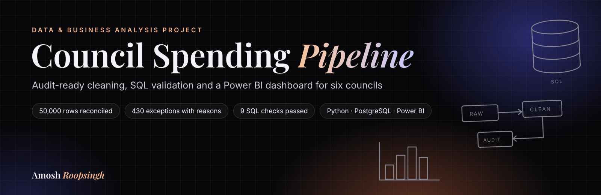

<p align="center">
  
</p>

<p align="center">
  
  
  
  
  
</p>

> **Course project** (Fortray AI-Powered Business Analyst Programme). All data is synthetic: the six councils, suppliers and figures are fictional. Supplier concentration, negative amounts and direct awards are **review signals, not proof of misconduct**.

## The question
Can a shared council finance team trust its spending figures, and see where spend differs from budget, without losing track of the rows it removes?

## The problem
- One monthly export of **50,000 transactions** from **six councils** (Jan 2024 – Sep 2026).
- **180** invalid dates, **250** negative amounts, **650** blank suppliers and **300** mistyped statuses (`"paid "`).
- Bad rows were deleted by hand with **no record**, and reports **disagreed** on what counts as spend.

## The solution
A three-layer pipeline. **Python** cleans the raw file and keeps every bad row in an exception file with a reason code. **PostgreSQL** checks, loads and audits the data in one safe transaction. **Power BI** reports spend, budget variance, suppliers and data quality.

## At a glance

| | |
|---|---|
| **Rows** | 50,000 in → 49,570 accepted + 180 rejected + 250 review (reconciled) |
| **Recorded Spend** | £494,674,327.33, identical in Python, SQL staging, final table and views |
| **SQL** | Staging + final tables, 9 validation checks, load audit, 4 reporting views |
| **Dashboard** | 4 pages: Overview, Budget Variance, Suppliers, Data Quality |
| **Documents** | BRD, data dictionary, insight readout, evidence screenshots |

## Pipeline at a glance

```
Raw CSV (50,000 rows, unchanged)
   │
   ▼  Python – profile, standardise, convert types, route exceptions
   ├── rejected/rejected_council_spend.csv   180 rows  (INVALID_DATE)
   ├── rejected/review_council_spend.csv     250 rows  (NEGATIVE_SPEND)
   └── processed/clean_council_spend.csv  49,570 rows  + quality_summary.csv
   │
   ▼  PostgreSQL – staging → 9 validation checks → promote in one transaction → audit log
   └── council.fact_spend (49,570 rows) + 4 reporting views
   │
   ▼  Power BI – 4-page dashboard (Overview, Budget Variance, Suppliers, Data Quality)
```

## Repository structure

| Folder | Contents |
|---|---|
| `Data/` | Raw source file `Local_Council_Spending_50000_rows.csv` – never modified |
| `python/` | `01_council_cleaning.ipynb` – profiling, cleaning, exception routing, feature engineering, reconciliation |
| `processed/` | `clean_council_spend.csv` (accepted rows + engineered columns), `quality_summary.csv` |
| `rejected/` | `rejected_council_spend.csv`, `review_council_spend.csv` – each row has `reason_code` and `source_row` |
| `SQL/` | `02_create_tables.sql`, `03_create_audit_tables.sql`, `04_validate_and_promote.sql`, `05_create_views.sql` |
| `Power BI/` | `Council_Spending_Dashboard.pbix`, theme JSON, page screenshots |
| `documentation/` | BRD, data dictionary & metric definitions, insight readout, `evidence/` screenshots of reconciliation and a successful run |

## Phase 1 – Python (data engineering & cleaning)

1. **Profile before changing anything:** row/column counts, blanks per column (`supplier_name` only: 650), duplicate IDs (0), value ranges, date coverage (1 Jan 2024 – 26 Sep 2026).
2. **Standardise text:** trim spaces; fix status labels with a mapping table (300 rows of `"paid "` → `Paid`).
3. **Strict type conversion** with `errors="coerce"`: invalid values become blank and are counted, never silently dropped.
4. **Route exceptions with reason codes and source row numbers:**
   - Rejected (hard failure): `INVALID_DATE` – 180 rows
   - Review (needs a human decision): `NEGATIVE_SPEND` – 250 rows
   - Pipeline also checks missing/duplicate ID, missing council or department, non-GBP currency and non-numeric spend (all 0 in this file); the run **stops** if any appear.
5. **Keep, don't drop, missing suppliers:** labelled `Not recorded` with `missing_supplier_flag = 1` (646 accepted rows).
6. **Engineered columns (vectorised, safe division):** `Is_Recorded`, `Variance_GBP`, `Variance_Pct`, `Recorded_Spend`, `Supplier_Share_Of_Council_Pct`.
7. **Reconcile and prove repeatability:** 49,570 + 180 + 250 = 50,000 ✅; restart-and-run-all produces identical outputs.

## Phase 2 – SQL (PostgreSQL)

- **Schema `council`** with a permissive **staging** table and a strict **final** table (`PRIMARY KEY`, `NOT NULL`, `CHECK` on status, currency, flags and non-negative spend, `DECIMAL(14,2)` for money).
- **9 validation checks** logged to `validation_log` per run; any failure blocks promotion.
- **Promotion in a single transaction** (full refresh) – reruns never create duplicates.
- **`load_audit`** records every run: input, accepted, rejected, review, staged and final rows, timestamps and status.
- **4 views:** variance register · monthly spend · supplier & procurement concentration · payment status & data completeness.

## Status inclusion rule

**Recorded Spend = Paid + Approved + Pending + Under Review.** `Cancelled` is excluded from every spend and budget total but kept in the data (and reported separately). Implemented once as the `Is_Recorded` flag and reused in SQL and Power BI.

## Row-count & value reconciliation

| Layer | Rows | Recorded Spend |
|---|---|---|
| Raw file | 50,000 | – |
| Python accepted (+180 rejected, +250 review) | 49,570 | £494,674,327.33 |
| SQL staging | 49,570 | £494,674,327.33 |
| SQL final (`fact_spend`) | 49,570 | £494,674,327.33 |
| SQL views 1–3 (sum) | – | £494,674,327.33 |
| Power BI – FY 2025/26 card vs SQL FY 2025/26 | – | £175.3M = £175,304,037.51 |

## Headline findings (plain English)

1. **Every council spent less than budget.** Recorded spend was £494.7M against a £518.6M budget – **£23.9M (4.6%) under**. Northbridge (−5.6%) and Greenvale (−5.1%) have the largest gaps.
2. **Almost half of recorded spend is not yet settled.** £124.7M is *Under Review* and £120.0M is *Pending* – together about **half (49.5%) of recorded spend** has not yet been paid or approved.
3. **Direct awards are significant and uneven.** Direct Award ranges from **17.5% (Eastford) to 23.0% (Greenvale)** of each council's recorded spend.
4. **No single supplier dominates.** Each council's largest supplier takes only **10.3–11.5%** of its recorded spend – close to an even split across the 11 named suppliers (~9% each).
5. **Data gaps are small but real.** 0.9% of rows were rejected or held for review, and **646** accepted rows (1.3%) have no supplier recorded.

Full detail, recommendations, limitations and follow-up questions: [`documentation/insight_readout.md`](documentation/insight_readout.md).

## Dashboard

Screenshots show **FY 2025/26** selected in the Financial Year slicer (the headline findings above use all years, so some percentages differ – e.g. Greenvale's Direct Award share is 27% in FY 2025/26 and 23% across all years).


## Environment

| Component | Version |
|---|---|
| Python | 3.14.6 (Anaconda, Windows 64-bit) |
| pandas | 3.0.3 |
| numpy | 2.4.6 |
| PostgreSQL | 19 (pgAdmin 4) |
| Power BI | Power BI Desktop |

Python packages are listed in `python/requirements.txt`.

## How to run

1. Open `python/01_council_cleaning.ipynb` in Jupyter (Anaconda) and **Run All**. Outputs are written to `processed/` and `rejected/`.
2. In pgAdmin, create database `council_spending`, then run `SQL/02_create_tables.sql` and `03_create_audit_tables.sql` once.
3. Import `processed/clean_council_spend.csv` into `council.stg_spend` (CSV, header on).
4. Run `SQL/04_validate_and_promote.sql`, then `SQL/05_create_views.sql`.
5. Open `Power BI/Council_Spending_Dashboard.pbix`.

Database credentials are never stored in the code.

## Known limitations & next improvements

- The promotion script holds the Python counts as typed values; next step is to load `quality_summary.csv` into SQL so it reads them automatically.
- The CSV is loaded into staging with pgAdmin's import tool; next step is a direct Python → PostgreSQL load (SQLAlchemy).
- High-value transactions (top 1% are above ~£334k, median ~£2.8k) are not yet flagged for review.
- Rejected/review counts in View 4 are load-level totals, repeated on each council row – do not add them up.
